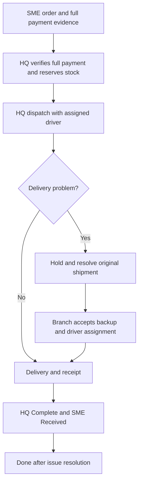

# Supplier and Branch Wholesale Platform

**Current supplier:** STT footwear only, with one Everyday sneaker model stocked by size and color.
SMEs and Drivers now have dedicated sign-in pages using HQ-issued credentials. See the
[portal endpoints and demo credential walkthrough](docs/stt-portals.md).

A supplier management and wholesale ordering platform connecting SMEs with a supplier's headquarters, retail branches, and delivery drivers.

**Project status:** Next.js + Supabase baseline and phase 2 order workflow implemented. The requirements below describe the intended full MVP; they are not all implemented. The newer [PRD](PRD_Driver_Registration_and_Live_Tracking.md) is the source of truth for HQ-managed accounts and full upfront payments.

Run `npm install`, copy `.env.example` to `.env.local`, then run `npm run dev` and open http://127.0.0.1:3000. Demo mode works without credentials. See [implementation and routes](docs/implementation.md), [Supabase setup](docs/supabase-setup.md), and [design references](docs/design.md). Use `npm test`, `npm run typecheck`, and `npm run build` to validate the baseline.

The connected workflow now includes saved STT quotes, private payment evidence, HQ review, atomic stock reservation, driver assignment/dispatch/handover, SME receipt, HQ completion, protected retail posting and sales-event reports. Local demo data persists in a private Postgres directory. The local app now connects to the hosted **Supply Link** Supabase project. See [live setup and first HQ login](docs/live-supabase.md). See [phase 2 walkthrough and API](docs/order-workflow.md). GPS, branch replacement deliveries, returns/refund accounting and account lifecycle controls remain future work.

## Overview

Headquarters focuses on wholesale orders. Branches primarily handle retail sales while maintaining protected stock for approved backup wholesale deliveries. SMEs can browse products, submit orders and full payment evidence, follow delivery progress, and confirm receipt.

Registered drivers share their location during assigned deliveries. Headquarters coordinates normal dispatch and branch takeover when a shipment encounters a problem. Sales reports remain available independently of GPS tracking.

## User roles

| Role | Responsibilities |
| --- | --- |
| SME | Register business details; browse products, wholesale prices, locations, and FAQs; order stock; pay the full order total and upload proof; track delivery; confirm receipt; view order history. |
| Headquarters | Manage catalog, prices, branches, and FAQs; verify full payments; allocate stock; approve drivers; control orders and delivery assignments; generate consolidated reports. |
| Branch Staff | Record retail sales and stock movements; view sales history; generate monthly reports; accept approved wholesale backup assignments. |
| Driver | Register for headquarters approval; view assigned deliveries; share location during delivery; report issues and handover. |

HQ and branch drivers use the same Driver role, with their affiliation and assignment determining access. Walk-in retail customers do not need accounts.

## Core features

- **Business registration:** SME business name, location, contact number, and account credentials.
- **Product discovery:** Product variants, pack sizes, wholesale prices, minimum quantities, availability, supplier and branch information, and FAQs.
- **Wholesale ordering:** Product quantities, receiver details, delivery address, shipping charges, and full order total due upfront.
- **Manual payment review:** Private screenshot upload, headquarters verification, rejection reasons, and resubmission history.
- **Delivery management:** Driver approval, dispatch assignments, order status updates, holds, and controlled branch backup.
- **Live tracking:** Driver location, dispatch source, destination, accuracy indication, and last-update time.
- **Branch operations:** Retail sale entry, stock updates, reversals, returns, protected wholesale reserves, and sales history.
- **Reporting:** Branch sales, headquarters summaries, wholesale operations, delivery exceptions, payment reviews, and CSV exports.

## Order workflow

1. HQ issues the SME account; the SME signs in and reviews the catalog, prices, locations, and FAQs.
2. SME selects products and quantities, enters delivery details, and reviews the final quoted total: goods after discounts plus shipping.
3. SME transfers the full order total outside the platform and uploads payment evidence.
4. Headquarters verifies that the actual transfer matches the full quoted total and checks available stock, then confirms the order and reserves stock. Underpayment or an amount mismatch requires correction before confirmation, preparation, or dispatch.
5. Headquarters assigns an approved driver and starts preparation and dispatch.
6. Driver shares location while the order is Shipping; SME follows the delivery timeline and map.
7. SME confirms actual receipt, and headquarters marks its fulfilment work Complete.
8. The system marks the order Done when both confirmations exist and no issue remains unresolved.

## Order statuses

| Status | Meaning |
| --- | --- |
| Draft | SME is preparing the order. |
| Awaiting verification | Full payment evidence is awaiting headquarters review. |
| Confirmed | Full payment has been approved and stock reserved. |
| Preparing | The assigned location is preparing the goods. |
| Shipping | An active delivery attempt has been dispatched. |
| On hold | A recorded issue needs resolution before normal fulfilment continues. |
| Complete | Headquarters has completed its fulfilment work; SME receipt may still be pending. |
| Done | Headquarters completion and SME receipt are confirmed, with no unresolved issue. |
| Cancelled | The order is cancelled, with stock release and payment follow-up recorded. |

Rejected payment evidence can be corrected and resubmitted. Payment review, fulfilment status, SME receipt, and delivery issues are maintained separately.

## Driver registration and live tracking

### Registration and assignment

- A driver registers a name, phone number, and account credentials.
- Headquarters approves the account and assigns headquarters or branch affiliation.
- Pending or suspended drivers cannot accept assignments or publish location.
- Drivers see only the receiver information, destination, parcels, and instructions needed for their assigned jobs.
- Drivers cannot approve payments, edit prices, mark headquarters Complete, or confirm SME receipt.

### Location sharing

- Driver explicitly permits location sharing on an HTTPS mobile page during Shipping.
- Each update belongs to a specific driver and delivery attempt and records coordinates, accuracy, capture time, and server receipt time.
- Target a **10-15 second** publication or map-refresh interval when fresh positions are available.
- After **60 seconds** without a fresh position, show the last known point with a clear stale-location message.
- Reject unassigned, replaced, invalid, or out-of-order location updates.
- Pause sharing on hold. Stop after handover, cancellation, reassignment, or driver suspension.

The initial web demo requires the tracking page in the foreground. Locking the phone, switching apps, permission denial, or loss of connectivity can interrupt updates. Keep manual status updates available. Reliable background tracking and precise live arrival predictions are future capabilities.

**A GPS point at the destination does not confirm delivery.** Only the SME confirms receipt.

## Headquarters and branch delivery attempts

An order can have multiple delivery attempts in its history, with only one active attempt for the MVP.

| Attempt type | Dispatch source | Tracking source |
| --- | --- | --- |
| Headquarters delivery | Headquarters warehouse | Assigned HQ driver |
| Branch backup delivery | Selected branch | Assigned branch driver |

When a shipment encounters a problem:

1. Headquarters places the order On hold and records the reason.
2. Headquarters confirms that the original consignment is stopped, returned, or otherwise resolved before authorising replacement.
3. A branch checks physical stock and accepts the backup assignment.
4. The system reserves branch stock and creates a replacement attempt under the same order.
5. Headquarters assigns its driver, informs the SME, and resumes fulfilment.
6. The SME map switches to the active replacement; the previous attempt remains in history.

If the same driver and parcel continue after a delay, resume the original attempt. If no branch can fulfil the complete order, keep it On hold and agree a revised plan with the SME. Automatic rerouting and split shipments are outside the MVP.

## Inventory and branch sales

- Track on-hand stock, protected wholesale reserves, allocations, and incoming transfers by location and product.
- Retail sales reduce branch stock once; duplicate submissions must not create duplicate sales.
- Retail availability excludes protected reserves and other commitments.
- Add incoming goods only after physical receipt.
- Preserve sale prices and pack conversions for historical reporting.
- Record voids, returns, and corrections as linked events rather than deleting history.
- Restore returned stock only when the goods are physically received and accepted.
- Treat branch backup dispatch as fulfilment of the original wholesale order, not a new retail sale.
- Treat internal headquarters-to-branch stock movement as a transfer, not revenue.

## Reports and exports

| Report | Required output |
| --- | --- |
| Branch retail sales | Daily, monthly, yearly, or custom-period history; monthly sales value, units, transaction count, and product breakdown. |
| Headquarters summary | Branch comparisons, retail and wholesale totals, product performance, and combined net merchandise sales. |
| Wholesale operations | Orders created in the period and their current statuses, plus a separately labelled count of orders reaching Done in the period. |
| Delivery and backup | HQ and branch dispatch attempts, distinct backup-served orders, hold reasons, and hold durations. |
| Payment review | Pending, rejected, and approved evidence counts; verified full payment amounts by approval date. |

Generate on-screen reports and CSV exports using the same filters and event cutoff. Headquarters can filter across branches; branch staff can access only their own branch reports. Include report period, timezone, currency, generation time, and relevant source references.

### Reporting rules

- Count retail sales on the confirmed sale date and wholesale sales when the order first reaches Done.
- Calculate net merchandise sales as gross sales minus discounts and posted returns or reversals.
- Post a later return as an adjustment in its own period; preserve the original sale history.
- Keep shipping and payment totals separate from merchandise sales.
- Verified full payments do not create additional sales; refunds are recorded separately.
- A failed HQ attempt followed by a branch replacement is **one order and two dispatched attempts**.
- Use the business timezone, proposed as **Asia/Yangon**, for date boundaries.
- Empty periods show zero totals. Exports must reconcile to the displayed report without silently truncating records.

Reports must continue to work when GPS data is unavailable. The same business events must produce the same sales totals as the manual-delivery version.

## Business and access rules

- An uploaded screenshot is payment evidence until headquarters verifies the actual transfer.
- Full upfront payment of 100% of the agreed order total, including shipping, is required before confirmation. Deposits, instalments, and later balance collection are not part of the flow; refunds are recorded separately.
- Agreed order prices, quantities, shipping, and destination are preserved as snapshots.
- Headquarters completion alone or SME receipt alone cannot produce Done.
- Restrict private orders, payment evidence, and location data to authorised users.
- Preserve actor, timestamp, and reason for important status, stock, payment, and assignment changes.
- Use retry-safe operations and atomic stock updates to prevent duplicate business effects.
- Finalise location retention, payment instructions and due time, shipping charges, refund handling, and any platform commissions before live trading.

## Delivery priorities

1. Build authentication, catalog, ordering, full payment review, stock, and receipt confirmation.
2. Complete branch sales, reporting calculations, filters, and CSV export.
3. Add driver approval, delivery assignment, foreground location publishing, and the SME tracking map.
4. Verify normal HQ delivery, missing GPS, branch replacement, access restrictions, and reporting reconciliation.

The full live-tracking version is a stretch for a three-day demo. Prioritise a working order and reporting flow, then demonstrate foreground tracking on separate devices.

## Future scope

- Reliable background tracking through a suitable mobile implementation.
- Route optimisation, improved arrival estimates, and automated delivery recovery.
- Payment gateway and refund integration.
- External POS integration and broader supplier support.
- Monthly AI stock planning using retail demand context, wholesale backup requests, inventory, and delivery history.

Until relevant history is available, stock-planning outputs should be manual targets or clearly labelled estimates approved by headquarters. AI and location data are not required for report generation.
