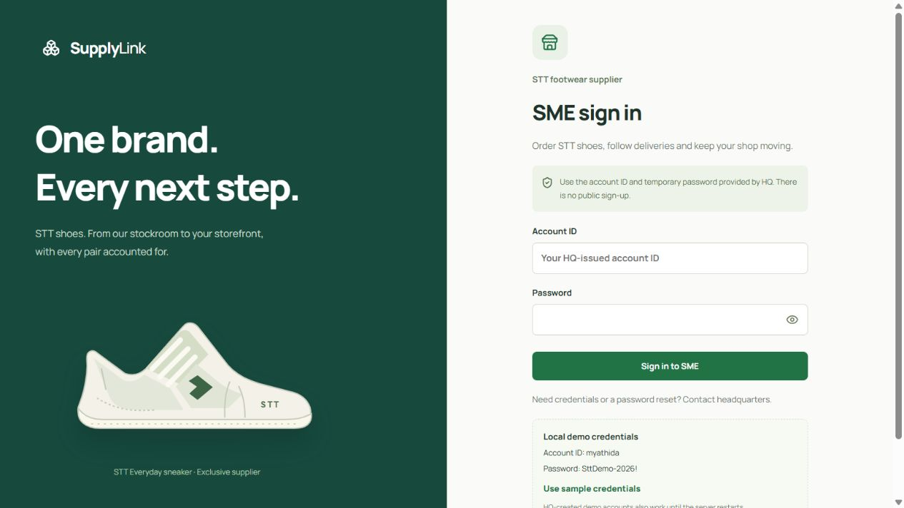

# Baseline delivery

Phase 2 supersedes the browser-only actions described in this original baseline note. All portals now require login and use saved transactional order/payment/stock/delivery operations. See [the current workflow guide](order-workflow.md) for implementation, API and verification details. Local testing was selected; hosted Supabase remains unconfigured.

Stack: Next.js App Router, React, TypeScript, Supabase Auth/Postgres/Storage, Manrope and Lucide.

## Local development

```
npm install
Copy-Item .env.example .env.local
npm run dev
```

Open http://127.0.0.1:3000. Without credentials, development defaults to the labelled demo.
The environment file explicitly enables that demo in a production preview. Live mode fails
closed without configuration; see `docs/supabase-setup.md` for connection and bootstrapping.

```
npm run test
npm run typecheck
npm run build
npm start
```

## Screen map

| Portal | Routes                                                                                       |
| ------ | -------------------------------------------------------------------------------------------- |
| HQ     | `/hq/login`, `/`, `/orders`, `/inventory`, `/branches`, `/accounts`, `/reports`, `/settings` |
| SME    | `/sme/login`, `/sme`, `/sme/catalog`, `/sme/orders`, `/sme/locations`, `/sme/settings`       |
| Driver | `/driver/login`, `/driver`, `/driver/deliveries`, `/driver/settings`                         |
| Branch | `/branch/login`, `/`, `/sales`, `/inventory`, `/reports`                                     |

`/login` selects a sign-in page. Authenticated roles override query parameters. SME and Driver
workspaces require a session even in demo mode. See `docs/stt-portals.md` for API contracts,
HQ-issued credentials, the first-login flow, and the STT catalog migration.

## Demo behaviours

One STT sneaker model with six size/color variants; per-variant quantities and stock; order
search/detail/CSV; draft quotes including shipping; HQ credential issuance and portal logins;
branch sale entry with protected-reserve check; date/channel report filters; notifications/help.
Order and retail UI changes use browser session storage. Demo identities and salted password
hashes live in server memory and reset on restart. Hosted mode uses Supabase exclusively.
Demo records use a fixed October 2026 fixture. New drafts and sales use the actual Yangon date.

## Verification scope

Domain tests exercise sales recognition, Yangon date boundaries, role navigation, demo data scope,
account validation, CSV selection and formula escaping. PGlite tests apply the migration and seed
to local Postgres with Supabase schema stubs, exercise RLS isolation, prevent client role writes,
check first-login password handling, and reject premature Done and excessive stock reserves.
Production build/type checking and browser checks cover
the integrated baseline. Hosted Supabase migrations and auth/account flows require a connected
project; local tests do not establish production RLS, operational or performance acceptance.

See `docs/design.md` for reference links, skill-driven design decisions and visual tokens.

## Updated on 21 October 2026

- 35 tests cover domain rules, configuration boundaries, migrations, RLS, portal login HTTP boundaries, live-mode profile checks (mocked Auth), and demo credential issuance/password lifecycle.
- Production build and TypeScript checks passed; formatting check passed.
- Browser checks passed for account creation/persistence, order search/detail, minimum-pack basket
  and draft quote, rejected/valid retail sales, filtered report export and driver financial privacy.
- Reviewed desktop and a 375px iframe viewport, including the mobile navigation drawer.
- Fresh production browser render passed after restarting the development server, which had
  retained a stale server bundle during hot reload. No hydration warning in the production preview.
- Supabase-hosted Auth, storage and migration execution remain unverified without project credentials.


