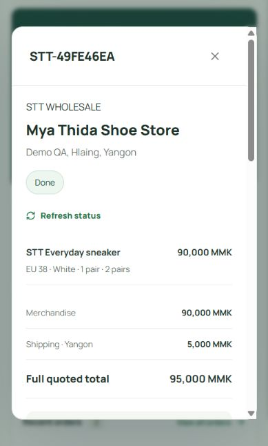

# Saved order and delivery workflow

Implemented in phase 2. The app uses Next.js server actions and authenticated HTTP routes with the same transactional Postgres functions in both modes. The hosted **Supply Link** Supabase project is now connected and its transactional workflow has passed rollback testing. See [live setup](live-supabase.md). The original local demo remains available with an explicit environment switch.

## Run locally

Set `NEXT_PUBLIC_DEMO_MODE=true`, run `npm run dev`, and open `/sme/login`. Use the sample-credential button. All four sample portals use `SttDemo-2026!`; IDs are `myathida`, `hq.admin`, `zawmin`, and `branch.hlaing`.

Orders, prices, settings, stock movements, payment metadata, retail sales and sales events persist in `.data/workflow` using PGlite Postgres. Proof images are private files in `.data/payment-evidence`. These files are ignored by Git. Run one app process against this directory. This adapter is for local development only; hosted deployments use Supabase. Sample shipping is 5,000 MMK, and payment instructions explicitly prohibit real transfers.

Demo authentication remains process-local: sample users return after a restart; sessions and newly HQ-issued demo credentials reset. A stale custom demo identity is suspended in the local ledger rather than having its order history removed. Use Supabase Auth for persistent issued accounts.

## Walk through an order

1. SME selects STT size/color variants in the catalog. The server validates minimums, quantities, current prices and available HQ stock. Review the entire quote, receiver phone and Yangon address, then save it.
2. The quote freezes quantities, unit prices, shipping and payment instructions. The SME uploads a PNG/JPEG proof (5 MB maximum) and the full amount/reference. The server checks actual image bytes, rejects excessive dimensions, strips metadata and stores a private normalized PNG. Versions remain in order history.
3. HQ opens **Wholesale orders**, views the private proof and checks the actual receiving account. Enter the actual received amount and explicitly confirm the account check. Approval requires the full quote including shipping. Rejection requires a reason; the SME can resubmit.
4. HQ approval allocates every SKU in one transaction, or allocates none. If stock has run out, payment approval remains recorded and the order stays Awaiting verification. HQ can replenish and retry reservation, or cancel with refund follow-up.
5. HQ selects an active driver with completed account setup, starts preparation, then dispatches. Dispatch consumes the reserved pairs once. An assigned driver sees receiver/parcel details and no order prices or proof images.
6. The driver reports handover. SME confirms actual full receipt. HQ confirms fulfilment completion after handover. Either confirmation can arrive first; **Done** and the wholesale sales event require both, with no open issue.
7. HQ, the assigned driver or the ordering SME can report an issue during delivery. Only HQ resolves the hold with a reason. Cancellation before dispatch releases allocations; verified payments are flagged for separate refund follow-up. The application never transfers or refunds money.

The workspace refreshes on focus and every 15 seconds while visible. An order also has a manual refresh control. GPS remains unimplemented; status changes never imply location tracking.

## Inventory, retail and reporting

HQ can record reasoned physical stock counts for HQ or a branch, and adjust future wholesale prices. Counts cannot fall below protected plus allocated stock. The branch posts actual pair quantities and selling prices; posting consumes only available branch stock and creates a retail sales event atomically.

Reports and CSV exports use the same immutable sales events and Asia/Yangon dates. Wholesale is posted once at Done, retail once when the sale is posted. Payments and shipping are excluded. The synchronous workspace explicitly fails above 10,000 orders rather than silently dropping records. Pagination, returns/reversals, refund accounting, branch replacement deliveries, GPS, and account suspension/reset controls remain future work.

## API

All operations require an active cookie session with completed first-login setup. Roles and ownership are checked in the database, not accepted from request payloads.

| Endpoint                                   | Purpose                                                 |
| ------------------------------------------ | ------------------------------------------------------- |
| `GET /api/workflow`                        | Role-scoped snapshot, plus `demo` mode flag             |
| `POST /api/workflow`                       | `{action, payload, key}`; `key` is a UUID retry key     |
| `POST /api/orders/:id/evidence`            | Multipart `file`, `amount`, `reference`, `operationKey` |
| `GET /api/orders/:id/evidence/:evidenceId` | Private normalized proof, HQ or ordering SME only       |

POST requires a matching Origin/Host. A retry key is bound to the actor, operation and payload; reuse the same key for an interrupted request. A successful replay returns its original result. Different details with that key are rejected. Proof upload retries bind the intent to the validated image digest and reuse a derived submission key.

Actions: SME `create`, `receive`, `hold`, `cancel`; Driver `handover`, `hold`; HQ `configure`, `stock`, `price`, `review_payment`, `confirm`, `assign`, `prepare`, `dispatch`, `complete`, `hold`, `resolve`, `cancel`; Branch `retail`. Order state adds further restrictions. Proof intent/submission helpers are exposed only via the validated upload route in the app; direct authenticated storage writes are denied.

## Supabase rollout

Apply all four migrations in order; see [setup](supabase-setup.md). Then configure a server-only storage/admin key, bootstrap HQ, sign in and configure the Yangon shipping quote and receiving-account instructions in **Settings**. Hosted defaults deliberately have no shipping quote. Add physical stock to each real branch before retail posting. No sample demo identities or orders are copied to the hosted database.

The RPCs run with a fixed empty search path, authorize using `auth.uid()` and lock inventory/order rows. Authenticated clients have no direct table mutation grants. New internal tables use RLS with no direct authenticated read/write grants; approved functions provide scoped access. Security-definer helpers are not callable by clients.

## Verification

`npm test`, `npm run typecheck`, `npm run build`. With the explicit local demo running on port 3000, `npm run smoke:workflow` signs in sample users and creates a labelled synthetic order through Done, including private image upload/download, access-denial checks, dispatch replay, and one sales event. It checks the demo flag before creating records. No real transfer is performed. Database tests cover stock contention, rejected/stale proof, cancellation/refund flag, ownership, driver scope and protected retail stock.

Verified on 21 October 2026: 43 tests, TypeScript, production build and the HTTP workflow smoke check passed. Browser verification confirmed saved quotes survive app restarts, the completed order retains its driver, and the mobile dialog prevents background scrolling. Hosted Auth/Storage and rollback workflow validation subsequently passed; see [live setup](live-supabase.md).

